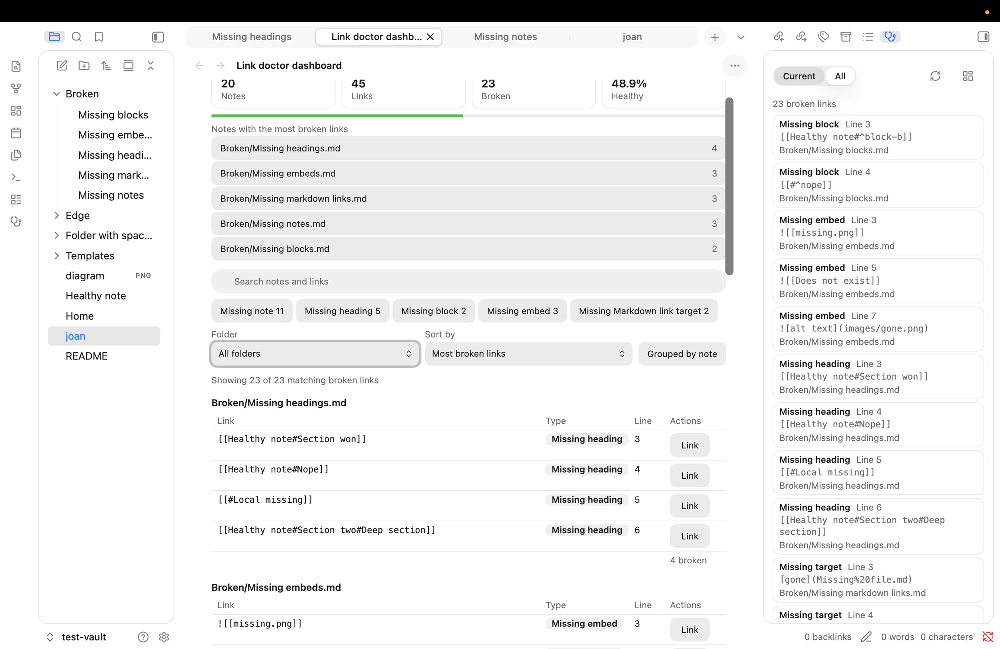
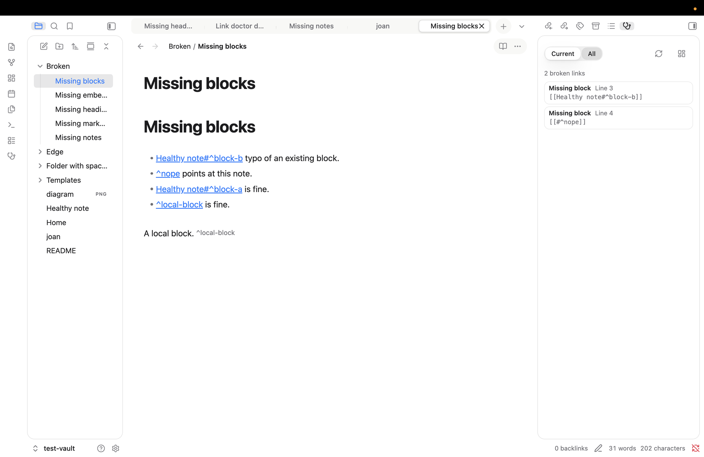

# Link Doctor

Find the broken links in your vault and jump straight to them.



## What it checks

- Links to notes that don't exist: `[[Missing note]]`
- Links to missing headings: `[[Note#No such heading]]`
- Links to missing blocks: `[[Note#^no-such-block]]`
- Embeds of missing files: `![[missing.png]]`
- Markdown links to missing files: `[text](missing.md)`

It also lists **empty notes**, meaning notes with nothing but frontmatter. Web links aren't checked.

It matches names the way Obsidian does (ignoring case and accent differences, handling relative paths and aliases) and works on desktop and mobile. It never edits your notes, and it makes no network requests. It lists every file path in your vault (never file contents) so it can tell whether a link target exists.

## How to use it



**Side panel** (stethoscope icon in the ribbon): **Current** shows the broken links in the note you're in, **All** shows the whole vault. Click a row to open the note with the link selected.

**Dashboard** (grid icon in the panel): health summary, search, filters by type and folder, grouping by note, and a **Link** button on every row.

## Settings

Choose the panel's starting mode, open notes in a new tab or the current one, switch link types on or off, ignore folders (for example `Templates/` or `Archive/**`), and set how quickly results refresh.

## Good to know

- It reads Obsidian's own index, so a brand-new note may take a moment to appear. Press **Rescan vault** if something looks stale.
- It finds broken links and takes you to them. It never changes your notes: there are no fix buttons, by design.

## Install

Once it's in the community list, search for **Link Doctor** in Settings, then Community plugins. To try it by hand, copy `main.js`, `manifest.json` and `styles.css` from a release into `<your vault>/.obsidian/plugins/link-doctor/` and enable it.

## For developers

```
npm install
npm run verify    # lint, types, tests, build
npm run dev       # watch build
```

Needs Node 22 or later. More in `docs/`. MIT licence.
